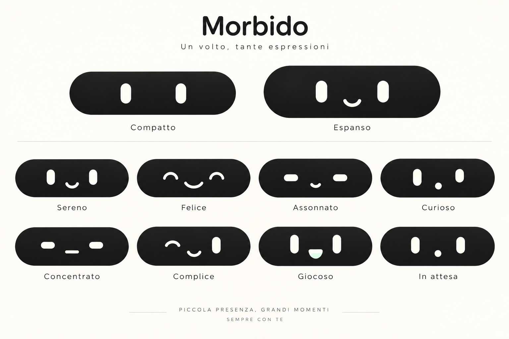

# Morbido — espressioni v10

Data: 2026-10-15
Modalità: imagegen integrato, con riferimento locale.

## Scelta dell'utente

Selezionata la prova 3, Morbido, della tavola v9: occhi verticali arrotondati e sorriso semplice a U. Compatto con soli occhi; espanso con occhi e bocca. Niente pupille, guance o rosa; superfici opache e gradienti leggeri.

## Tavola

Otto espressioni di studio: Sereno, Felice, Assonnato, Curioso, Concentrato, Complice, Giocoso, In attesa. Sono proposte visive, non un inventario degli stati tecnici del software. Immagine statica: animazioni e integrazione nell'app non implementate in questa consegna.

## Verifica visiva

Tavola generata e riaperta dal file salvato: due modalità e otto espressioni, caption leggibili, nessuna pupilla o guancia rosa. Il generatore ha aggiunto un motto nel footer: testo illustrativo non richiesto, non adottato come copy del prodotto.

## Riferimento

notch-face-kawaii-10-prove-v9.png, seconda riga a sinistra, prova 3.

## Prompt

Create a refined visual design board for the selected minimalist kawaii desktop notch companion, variant 3 "Morbido" in the supplied reference board. The reference image is a comparison sheet; use ONLY the design in the SECOND ROW LEFT, label 3 Morbido, as the exact character identity. Its neutral face consists of two upright rounded vertical pill eyes and a small single U-shaped smile. Ignore all other design alternatives.

Produce a beautiful high-resolution landscape design presentation on a warm off-white background, precise generous spacing and restrained clean Italian typography. Top heading "Morbido" and small subtitle "Un volto, tante espressioni". At top show two larger hero examples with captions "Compatto" and "Espanso": compact is a shallow matte near-black rounded notch with ONLY the two vertical pill eyes centered; expanded is a taller matte near-black rounded notch with the same larger eyes and a small U smile. The whole notch is the face, no separate avatar silhouette or body.

Below show exactly eight expression studies arranged as 4 columns by 2 rows, each in the same wide matte charcoal rounded notch, labelled clearly beneath: "Sereno", "Felice", "Assonnato", "Curioso", "Concentrato", "Complice", "Giocoso", "In attesa". Maintain ONE recognizable character from #3 across expressions: Sereno vertical pill eyes and simple U smile; Felice eyes gently compressed into happy rounded arcs and wider curved smile; Assonnato softened horizontal sleepy pill eyes and tiny relaxed mouth; Curioso vertical pill eyes with slight asymmetric squash and tiny round mouth; Concentrato shorter rounded pill eyes and small straight rounded mouth; Complice one softly closed rounded eye line and one vertical pill eye with tilted U smile; Giocoso stretched vertical eyes and small open rounded happy mouth; In attesa upright neutral pill eyes with tiny round mouth. No eyebrows or decorative symbols.

Style: contemporary Japanese kawaii with premium Apple-like visual restraint, graphic 2D minimalism, smooth rounded matte opaque shapes, subtle ivory-to-pale-mint gradients within solid facial marks and almost imperceptible tonal gradient in the charcoal notch. Soft and rubbery through contour design only, NOT 3D rendering. No pupil or iris, no holes or inner sparkles in eyes, no gloss, no shiny highlights, no blush, NO CHEEKS, NO PINK anywhere, no nose, no ears, no hair, no body, no robot casing, no avatar container, no neon, no pixelated LED, no bevel, no realistic shadows. Facial features are filled soft ivory or pale mint; mouth curves use thick smooth rounded strokes, open mouths solid muted mint. Consistent proportions and centered features. A clean credible UI concept sheet ready for further animation design.
